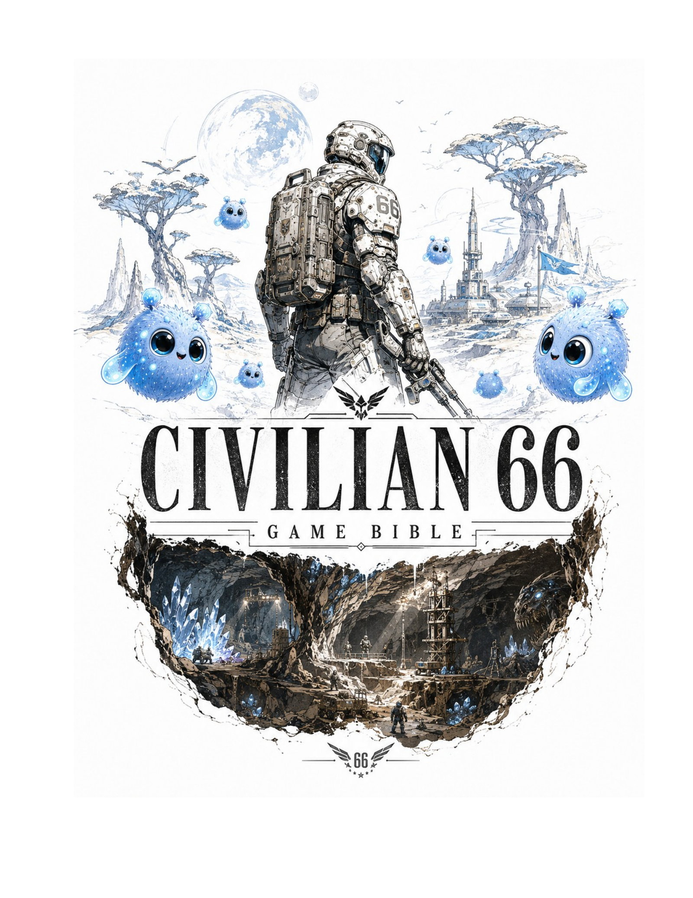
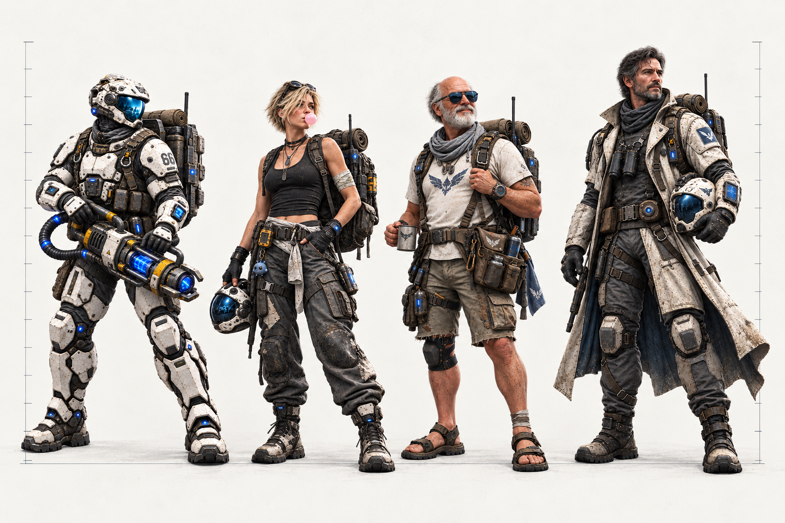
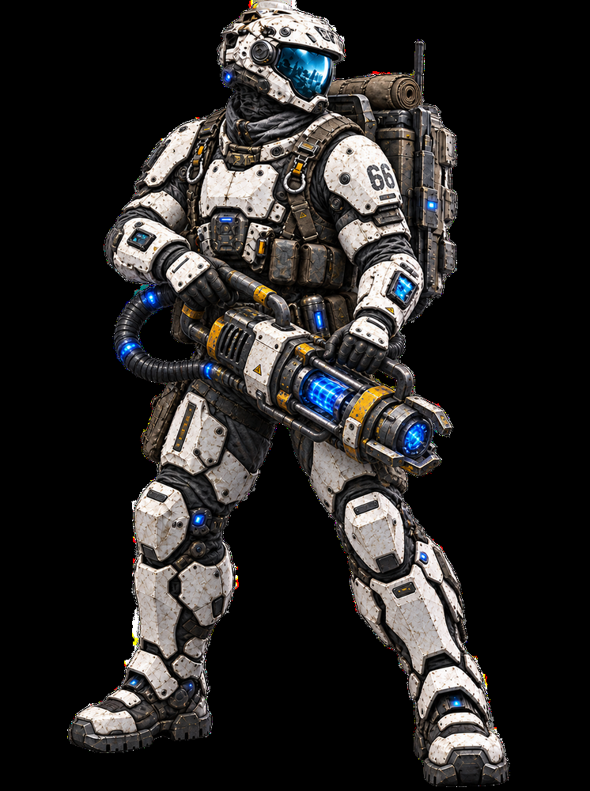
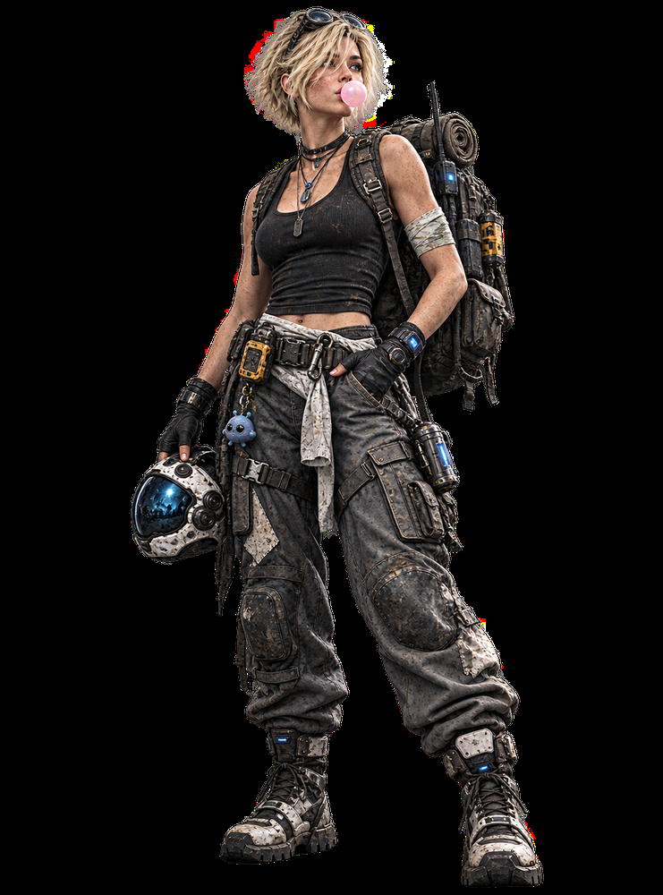
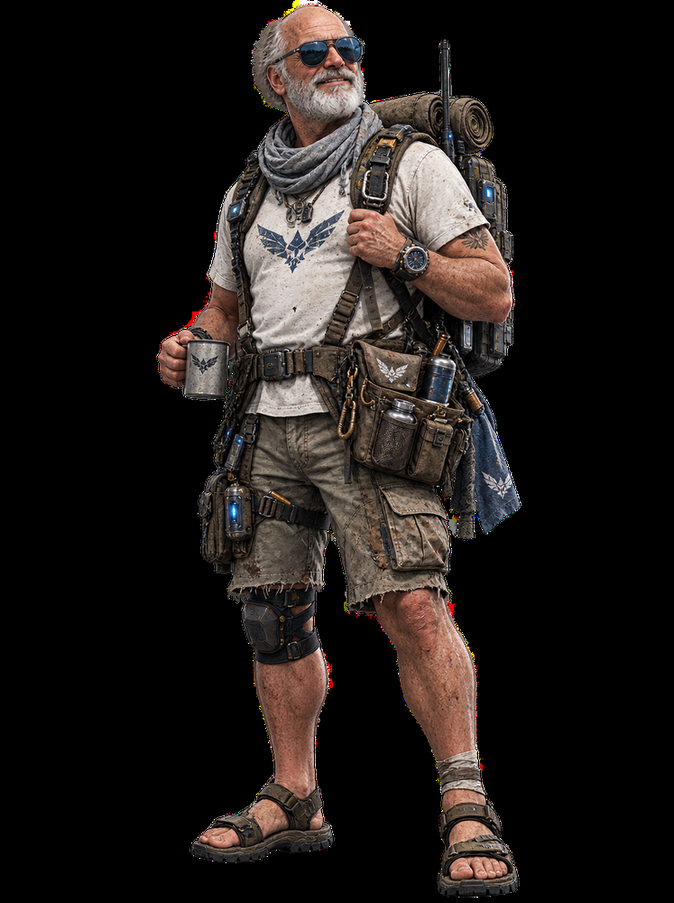
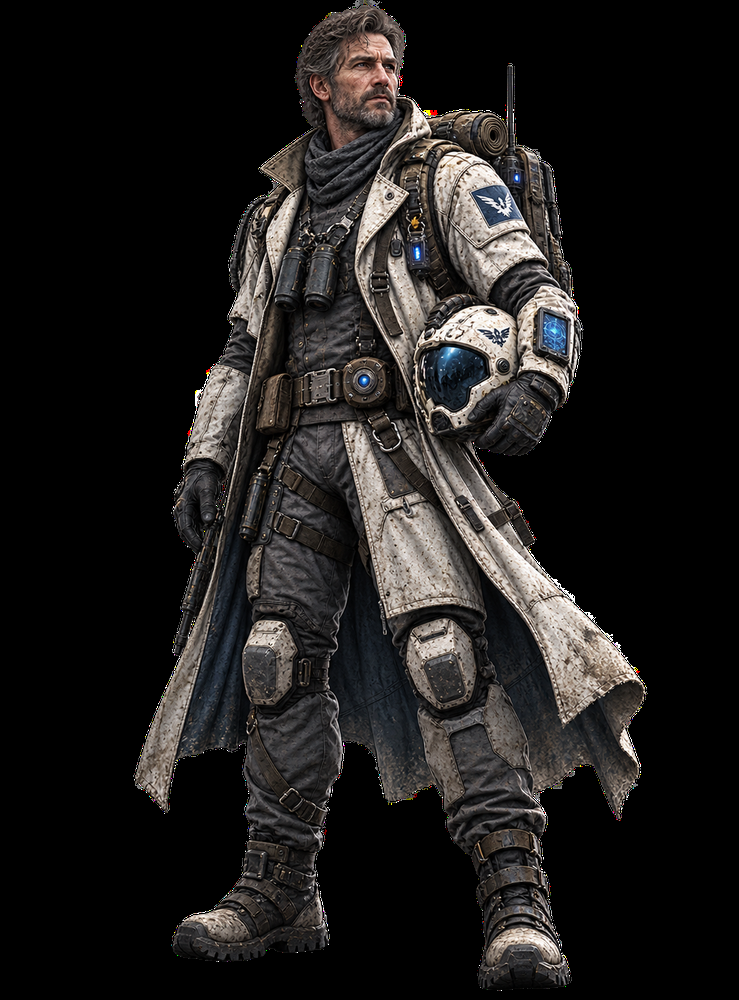
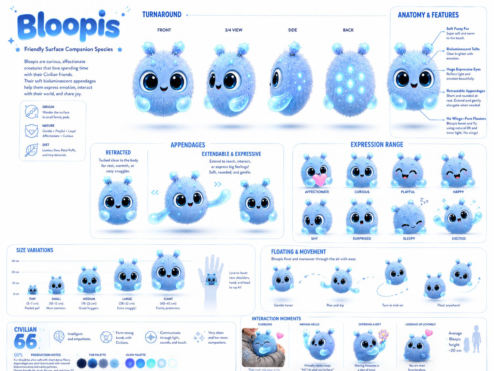
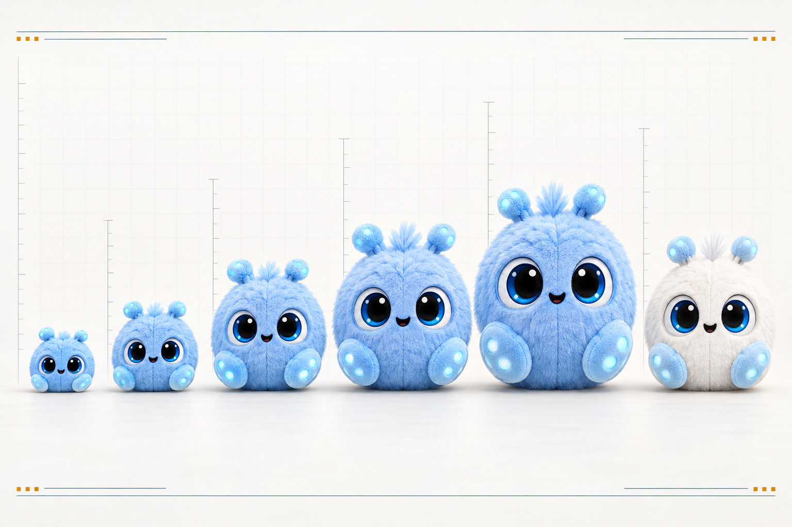

# Joseph Edwards | Gameplay Systems & Technical Design

  

  <strong>GAMEPLAY SYSTEMS · PROGRESSION · TECHNICAL DESIGN</strong> 
  I turn complex game ideas into clear player loops, connected systems, and implementation-ready decisions.

  <a href="https://www.linkedin.com/in/josephedwardscto/">LINKEDIN</a> &nbsp;·&nbsp;
  <a href="https://github.com/RawPowered/Civilian66-Public">CIVILIAN 66 SHOWCASE</a> &nbsp;·&nbsp;
  <a href="RESUME.md">RESUME</a> &nbsp;·&nbsp;
  <a href="#selected-design-work">DESIGN WORK</a>

## Who I am

I am an independent game designer with a systems and operations background. My strongest work sits where player progression, resource flow, settlement growth, and implementation meet. I make the rules legible, connect them to player outcomes, and document what a team needs to build and review them.

I am looking for **Associate Game Designer**, **Gameplay Systems Designer**, **Progression Designer**, and **Technical Game Designer** opportunities. My best fit is a team building exploration, survival, strategy, crafting, or persistent-world systems.

<table>
<tr>
<td width="50%" valign="top">
<h3>What I bring</h3>
<ul>
<li>Systems thinking grounded in dependencies, resource flow, progression gates, and edge cases.</li>
<li>Clear feature documentation that connects player intent to implementation decisions.</li>
<li>Operational experience managing business systems, migrations, workflows, and user needs.</li>
<li>Comfort working across design, engineering, interfaces, and validation.</li>
</ul>
</td>
<td width="50%" valign="top">
<h3>How I contribute</h3>
<ul>
<li>Define the player problem and the intended outcome.</li>
<li>Map rules, prerequisites, failure cases, and feedback to the player.</li>
<li>Work with implementation constraints and track design status honestly.</li>
<li>Use play evidence and review to identify what is ready and what needs revision.</li>
</ul>
</td>
</tr>
</table>

## Selected design work

<table>
<tr>
<td width="50%" valign="top">
<h3><a href="case-studies/progression-and-settlement.md">Progression &amp; settlement systems</a></h3>

Connects player authorization, Credits, materials, procurement, base-building, and campaign milestones into outcomes the player can see and use.

<strong>Focus:</strong> progression design · economy · feature dependencies

</td>
<td width="50%" valign="top">
<h3><a href="case-studies/campaign-structure.md">Campaign structure</a></h3>

Shapes a journey from underground survival to surface exploration, first contact, the Subvergence, and a colony capable of reaching Earth.

<strong>Focus:</strong> campaign design · world progression · gameplay and story

</td>
</tr>
<tr>
<td width="50%" valign="top">
<h3><a href="case-studies/design-to-implementation.md">Design to implementation</a></h3>

Shows how creative direction becomes scoped systems, implementation notes, dependencies, acceptance criteria, and evidence boundaries.

<strong>Focus:</strong> technical design · feature communication · validation

</td>
<td width="50%" valign="top">
<h3><a href="https://github.com/RawPowered/Civilian66-Public">Civilian 66 public project</a></h3>

Review the game overview, art direction, resource credits, and Unreal code-set map. The public repository is a curated project showcase.

<strong>Status:</strong> independent game in development. No public playable build is offered.

</td>
</tr>
</table>

## Civilian 66 in one minute

*Civilian 66* begins as a survival and settlement game beneath the surface. The player mines, fights, builds, trades, and reconstructs a five-part drill to break through. The surface opens a new layer of exploration and first contact. Meeting Clarissa is when the player earns a personal name. Later, the Subvergence brings magic into the changed world, while the colony continues growing toward its first message to Earth: **"Hello World."**

The game direction treats the settlement as part of campaign progression. What the player establishes, powers, researches, and protects changes what they can do next. See the [campaign case study](case-studies/campaign-structure.md) and the [public game showcase](https://github.com/RawPowered/Civilian66-Public).

  

<em>Game Bible cover art used in the public project showcase.</em>

<em>Main character production concept. Art direction reference, not final in-game footage.</em>

## Character art and merchandise direction

<em>Generated lineup study based on four Bible v1.10 character dossiers. It is a visual comparison, not a final measured scale sheet.</em>

<table align="center">
<tr>
<td width="50%" align="center" valign="top" bgcolor="#111820"><strong>Civilian 66</strong> </td>
<td width="50%" align="center" valign="top" bgcolor="#111820"><strong>Clarissa</strong> </td>
</tr>
<tr>
<td width="50%" align="center" valign="top" bgcolor="#111820"><strong>Bruce</strong> </td>
<td width="50%" align="center" valign="top" bgcolor="#111820"><strong>The Commander</strong> </td>
</tr>
</table>

**Height references:** Civilian 66 is approximately 180 cm. The Bible does not set heights for Clarissa, Bruce, or the Commander. Bloopis average about 20 cm, with five documented in-world size variants from 5 to 45 cm.

### Bloopi visual reference

The current species sheet establishes the Bloopi silhouette, expressions, color range, and in-world sizes. It contains creature art, but I found no prior plush concept or product specification in the project files reviewed.

<em>Selected species reference from the current visual direction.</em>

### Proposed Bloopi plush line

This new product exploration carries the five in-world size classes into a plush range and adds a white companion edition. The image is a concept, not a finalized product design.

<em>Generated merchandise concept art. Product details remain open.</em>

[Character artwork, scale notes, and plush line concept](case-studies/characters-and-merchandising.md)

## Transferable experience

Before focusing this portfolio on game design, I worked across business systems, CRM administration, integrations, automation, web interfaces, and operational support. That work taught me to ask how a system behaves for the person using it, where information can break, what teams need from a handoff, and how to distinguish a working result from an assumption.

At Expert Solar, I administered business systems, took over internal CRM delivery requests, and supported a Salesforce-to-Zoho transition. My reported outcome was a reduction of approximately **$20K per month** in external development expense after delivery moved in-house. The profile portfolio describes the available evidence and its limits.

## Tools and authorship

My current game work uses an Unreal Engine C++ project and GitHub for source organization and review. My broader technical background includes TypeScript, JavaScript, Python, PHP, SQL, REST APIs, workflow automation, and responsive interfaces.

I use Cursor and Codex as development tools. I own the design direction, scope, system decisions, review, debugging, and the distinction between implemented work and design targets. Individual examples identify their current status so a reviewer can see what the project demonstrates.

## Review the work

- [Resume](RESUME.md) for a role-focused summary of experience and skills.
- [Selected design work](#selected-design-work) for focused case studies.
- [Civilian 66 public showcase](https://github.com/RawPowered/Civilian66-Public) for the game overview, art direction, credits, and Unreal code-set map.
- [Professional profile](https://github.com/RawPowered) for broader systems, automation, and product-interface work.
- [Connect on LinkedIn](https://www.linkedin.com/in/josephedwardscto/).

Creative direction follows Civilian 66 Game Bible v1.10. The complete Bible, full source, and production assets remain in the private production repository. This portfolio summarizes selected design work and does not claim that every described feature is complete or validated in a public build.
