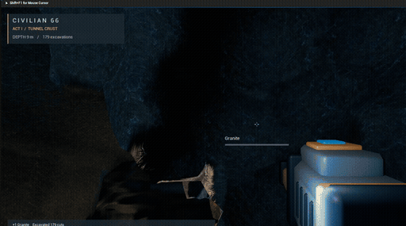
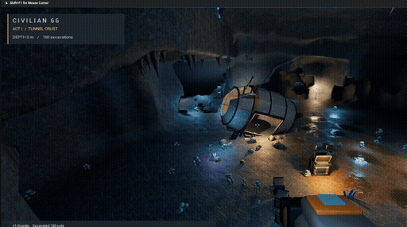
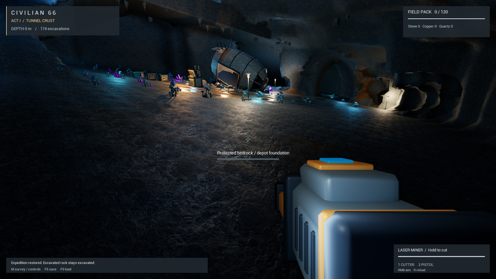
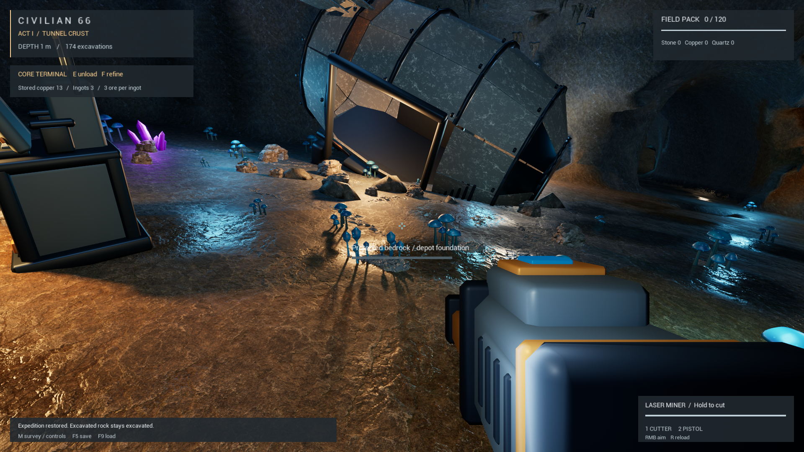
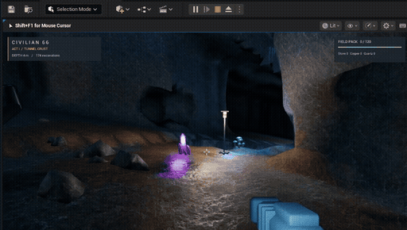
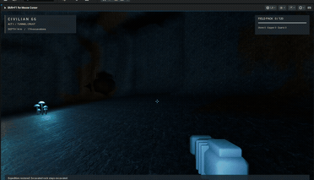

# Civilian 66 | Early Unreal Playable Preview

<strong>LIVE PLAY IN EDITOR CAPTURE · UNREAL ENGINE 5.8.2 · 25 OCTOBER 2026</strong>

## The playable slice

Civilian 66 is a science-fiction adventure that begins underground. This early Unreal preview gives a first look at its opening mine: an underground landing pocket where the player explores, surveys the space, uses a laser miner, and works around a core terminal.

These images and short clips come from recordings of the finite mine running in Unreal Editor. They show in-engine environment art, first-person tool use, player-facing exploration and inventory information, and a live terminal state.

<em>Current gameplay capture from October 25, 2026. Six seconds from a longer recording.</em>

<em>A second moment from the same session, approaching the core terminal.</em>

<em>The opening pocket, restored landing site, tunnel routes, laser miner, and in-game HUD.</em>

<em>At the core terminal, the HUD shows 13 stored copper, 3 ingots, and a three-ore-per-ingot refining ratio.</em>

## What the captures support

- A real-time, first-person preview runs in Unreal Engine 5.8.2.
- The finite mine opening contains a traversable underground space, landing site, tunnel routes, lighting, and environmental details.
- The live interface surfaces Act I, Tunnel Crust, player depth, excavation count, field-pack capacity, resource counts, and laser miner controls.
- The core terminal exposes unload and refine actions and displays a stored resource state.

The screenshots show a restored local test session. They document a playable development preview, not a clean first-run sequence or a completed feature acceptance pass.

## Project status and access

This is an early opening-pocket preview in active development. It does not represent the full Civilian 66 campaign, the complete First Civilization Slice, or a finished release. The later journey from underground survival through the surface, first contact, and the Subvergence remains part of the wider game direction.

There is no downloadable public build in this showcase. The editor project, full source, complete Game Bible, and production assets remain in the private repository. This page shares selected screenshots so reviewers can see the current project running without exposing those materials.

Earlier development captures from September 7, 2026

These two clips predate the October recording and show earlier movement through the same underground development level. They are included as dated development context, not as the latest capture.

<em>Recorded September 7, 2026. Earlier movement through the underground mine and its lit resource pockets.</em>

<em>Recorded later the same evening. Another view of the mine routes, landing pocket, and field interface.</em>

<a href="../README.md">Back to the design portfolio</a> · <a href="https://github.com/RawPowered/Civilian66-Public">Civilian 66 public project showcase</a>

